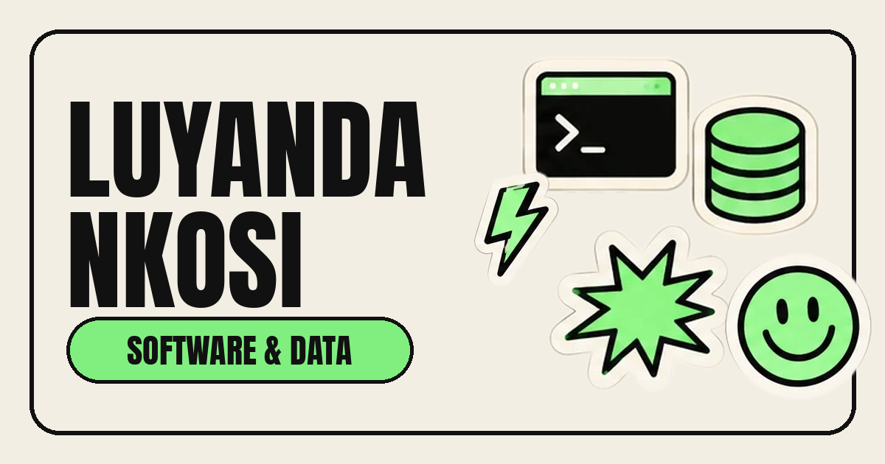

<!-- Brand palette: ink 111111 · cream F3EEE3 · green 80EF80 (same as the live site) -->

<p align="center">
  <a href="https://luyandankosi.netlify.app/">
    
  </a>
</p>

<p align="center">
  
</p>

<p align="center">
  <a href="https://luyandankosi.netlify.app/"></a>
  <a href="https://www.linkedin.com/in/luyanda-nkosi-34578b350/"></a>
  <a href="mailto:laynkosi1304@gmail.com"></a>
</p>

<p align="center">
  <a href="https://app.netlify.com/projects/luyandankosi/deploys"></a>
  
  
  
</p>

<br>

<p align="center">
  <a href="https://luyandankosi.netlify.app/">
    
  </a>
</p>

---

## ▌About the project

My personal portfolio: a fast, responsive, hand-built website showing my projects, skills, process and experience, with a simple way to get in touch. It is written in plain **HTML, CSS and JavaScript** with no frameworks and no build step, and deployed on **Netlify**, so every push to `main` goes live in about a minute.

The look is street-style: ink black, cream and pastel green, with custom sticker artwork, a ticker, stacked process cards and a drippy footer.

---

## ▌Features

<table>
  <tr>
    <td width="33%" valign="top">
      <h3>🎨 Design</h3>
      Fully responsive layout, custom sticker library and a single shared stylesheet used by every page.
    </td>
    <td width="33%" valign="top">
      <h3>♿ Accessibility</h3>
      Skip-to-content link, semantic landmarks, labelled controls and live-region form messages.
    </td>
    <td width="33%" valign="top">
      <h3>✉️ Contact form</h3>
      Client-side validation, Netlify Forms delivery, honeypot, timing check and a send cooldown against spam.
    </td>
  </tr>
  <tr>
    <td width="33%" valign="top">
      <h3>🔒 Security</h3>
      Strict Content Security Policy, HSTS, <code>X-Frame-Options</code>, <code>Referrer-Policy</code> and <code>Permissions-Policy</code> via <code>_headers</code>.
    </td>
    <td width="33%" valign="top">
      <h3>🍪 Privacy first</h3>
      Cookie consent banner. Cookie-free GoatCounter analytics only load after a visitor clicks Accept.
    </td>
    <td width="33%" valign="top">
      <h3>🔎 SEO ready</h3>
      Sitemap, <code>robots.txt</code>, structured data, Open Graph image and web app manifest.
    </td>
  </tr>
</table>

Also included: a custom **404 page**, **Privacy Policy** and **Terms & Conditions** pages, and a `security.txt` contact file.

---

## ▌Tech stack

<p align="left">
  
</p>

| Layer | Tools |
| --- | --- |
| Front end | HTML5, CSS3, vanilla JavaScript |
| Hosting and forms | Netlify with continuous deployment from this repo |
| Analytics | GoatCounter (cookie-free, consent-gated) |
| Local development | Node.js (optional) for the included dev server |

---

## ▌Project structure

```text
.
└── luyanda-portfolio-v2/
    ├── index.html             Main portfolio page
    ├── privacy.html           Privacy Policy
    ├── terms.html             Terms & Conditions
    ├── 404.html               Custom "page not found" page
    ├── style.css              Single stylesheet for every page
    ├── script.js              Navigation and page interactions
    ├── assets/
    │   ├── form.js            Contact form validation and submission
    │   ├── consent.js         Cookie consent banner
    │   ├── analytics.js       GoatCounter loader (runs after consent)
    │   └── stickers/          Optimised WebP artwork
    ├── sticker-library/       Master sticker files (PNG, SVG, WebP)
    ├── _headers               Netlify security and caching headers
    ├── _redirects             Netlify redirects
    ├── sitemap.xml · robots.txt · site.webmanifest
    ├── .well-known/security.txt
    └── dev-server.js          Local server that also serves the 404 page
```

---

## ▌Run it locally

No dependencies to install. You only need [Node.js](https://nodejs.org/) for the optional dev server.

```bash
git clone https://github.com/laynkosi1304-cmd/luyanda-portfolio.git
cd luyanda-portfolio/luyanda-portfolio-v2
node dev-server.js
```

Open <http://localhost:5500>, then visit any address that does not exist (for example `/nope`) to see the custom 404 page.

> [!NOTE]
> The site uses root-relative paths such as `/style.css`, so always serve the `luyanda-portfolio-v2` folder itself, not its parent. With the VS Code Live Server extension, open that folder in VS Code first.

---

## ▌Deployment

Every push to `main` is built and published by Netlify.

| Setting | Value |
| --- | --- |
| Branch to deploy | `main` |
| Build command | *(empty)* |
| Publish directory | `luyanda-portfolio-v2` |

---

## ▌Repository activity

Live numbers for this repository. They update automatically on every push.

<p align="center">
  
  
  
  
  
</p>

<p align="center">
  
  
</p>

<p align="center">
  
</p>

---

## ▌Let's talk

Open to collaboration and learning opportunities.

<p align="left">
  <a href="https://luyandankosi.netlify.app/"></a>
  <a href="https://www.linkedin.com/in/luyanda-nkosi-34578b350/"></a>
  <a href="mailto:laynkosi1304@gmail.com"></a>
</p>

<p align="center">
  
</p>

<p align="center"><sub>&copy; 2026 Luyanda Nkosi. All rights reserved.</sub></p>
